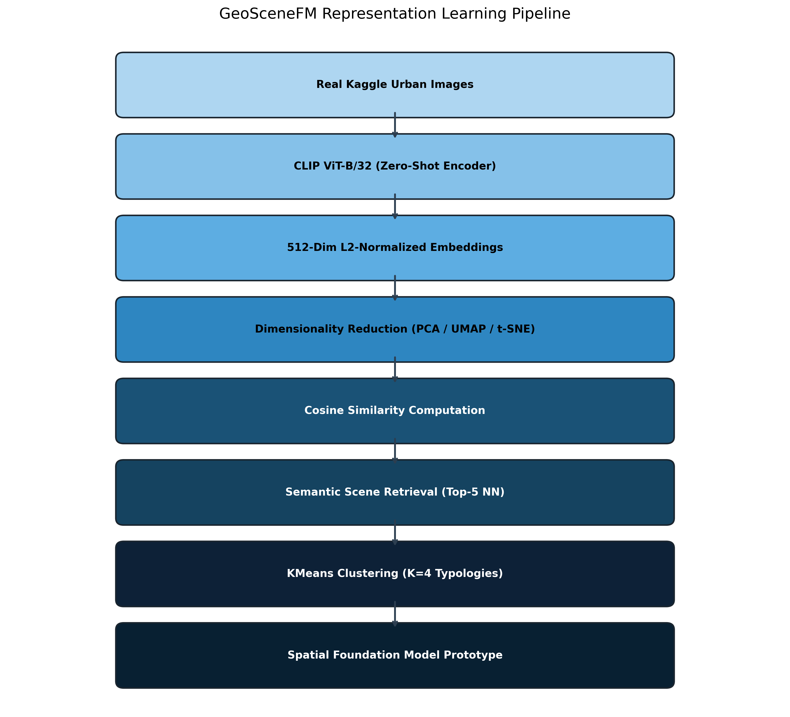
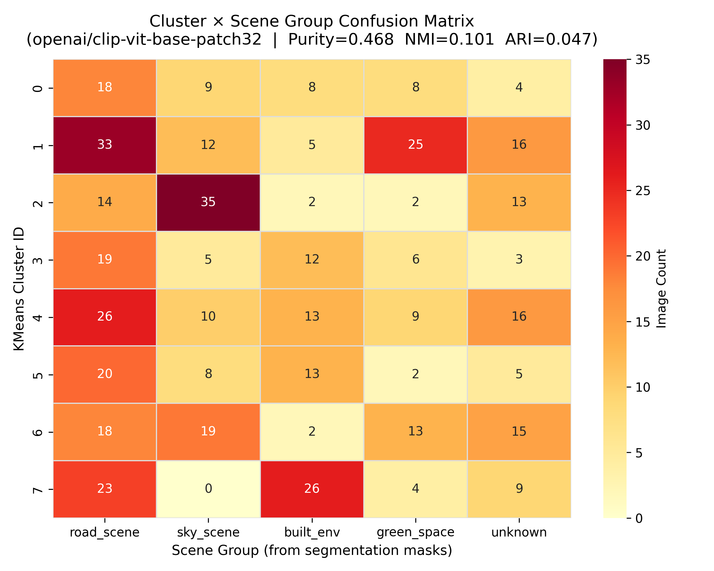
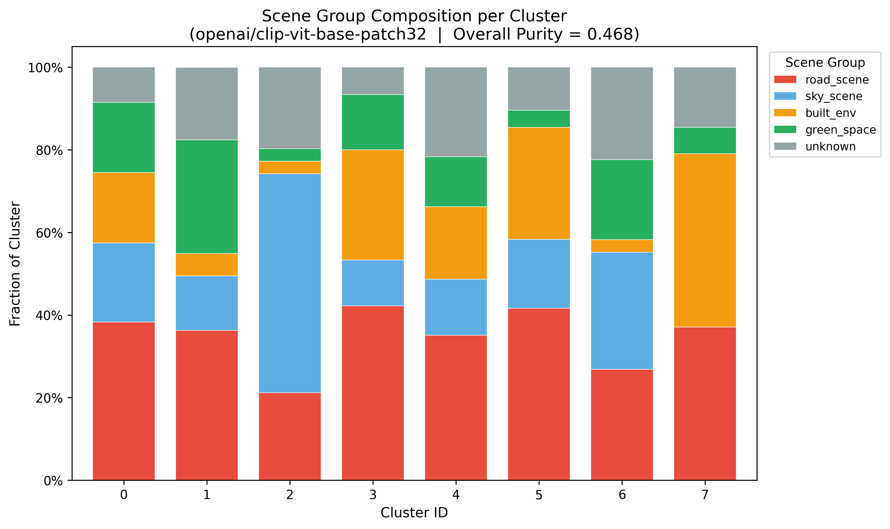
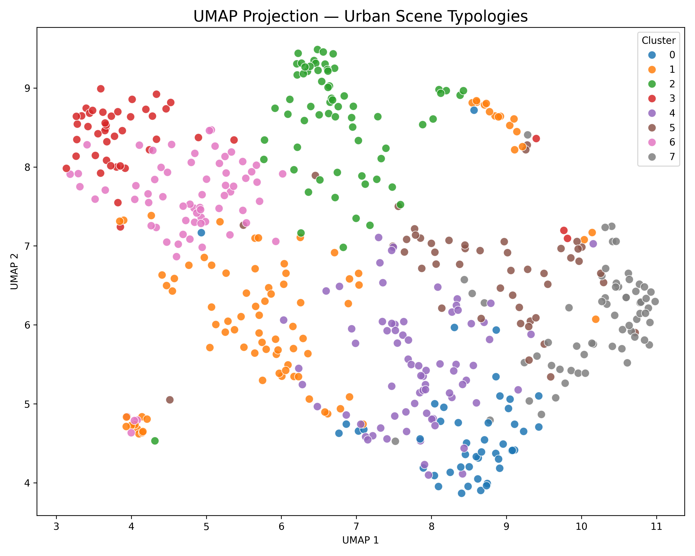
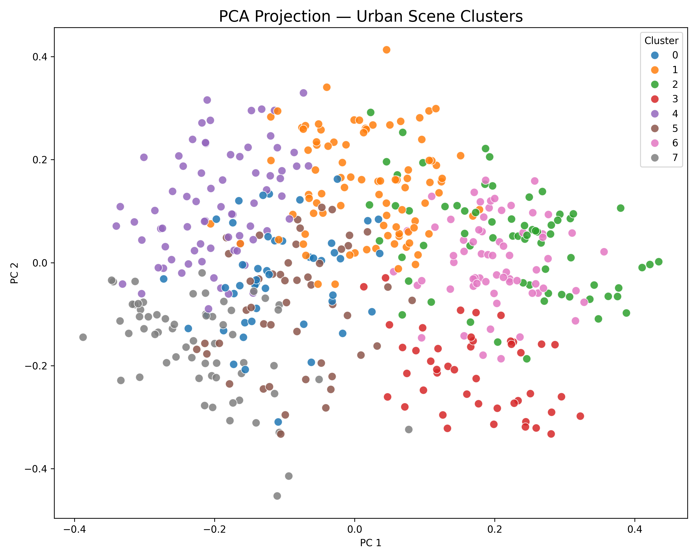
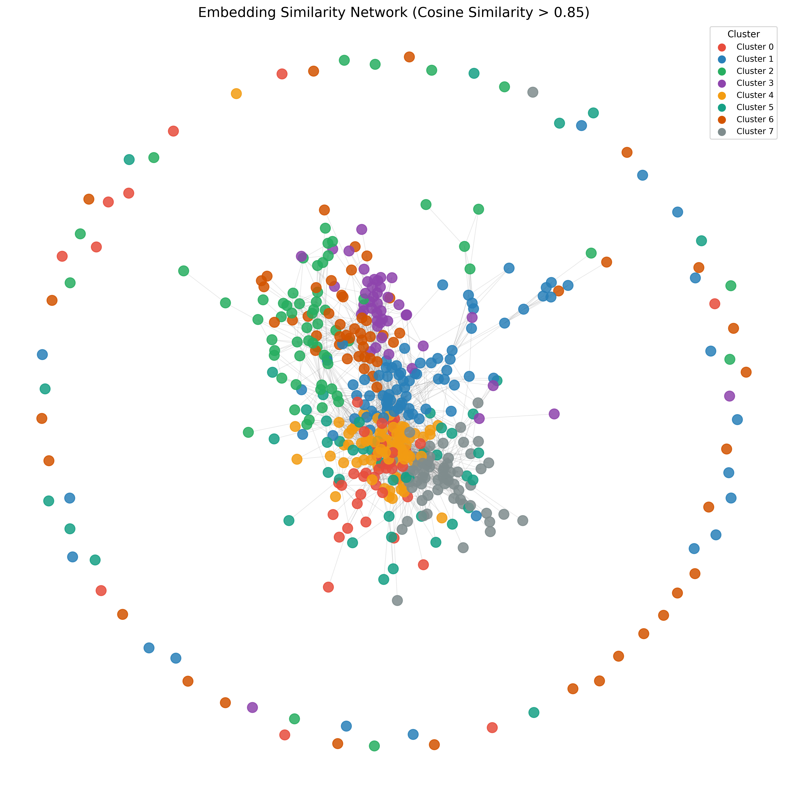
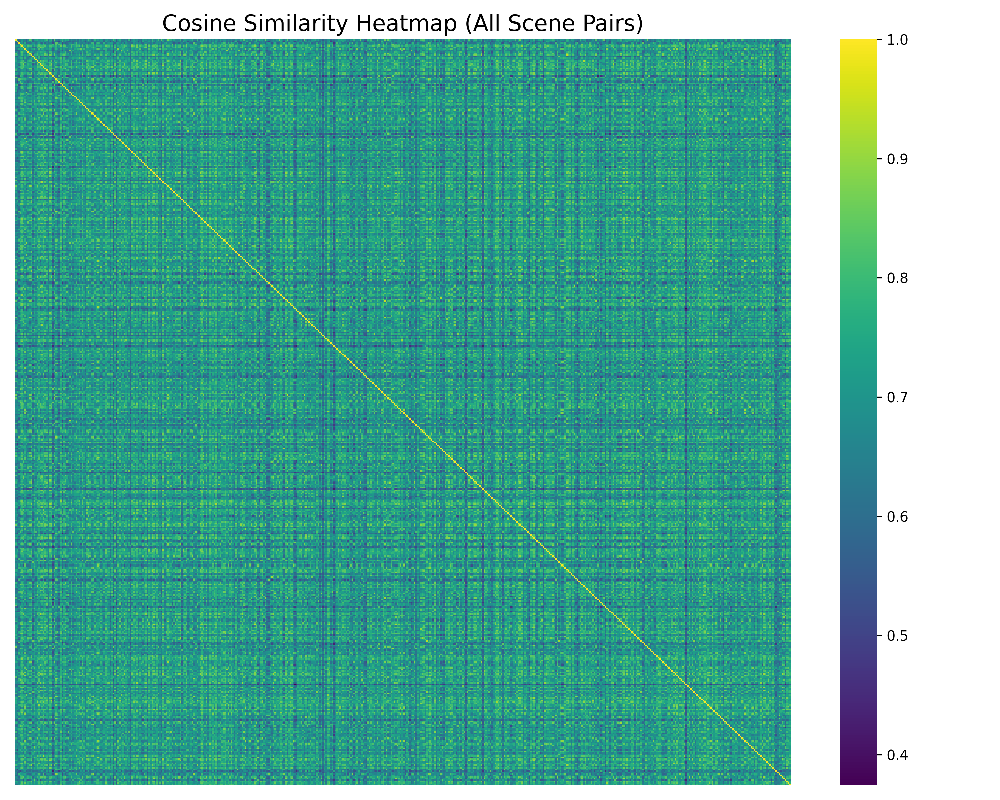

# GeoSceneFM: A Spatial Foundation Model Prototype for Urban Scene Representation Learning

[](https://www.python.org/downloads/)
[](https://pytorch.org/)
[](https://huggingface.co/openai/clip-vit-base-patch32)
[](https://www.mapillary.com/dataset/vistas)
[]()
[](LICENSE)

> **Lead Researcher:** **Nazar E Imam**  
> **Academic Background:** B.E. in Geoinformatics Engineering, National University of Sciences and Technology (NUST), Islamabad, Pakistan (CGPA: **3.52 / 4.00**)  
> **Application Target:** Fully Funded Master's and Ph.D. Programs in the United States (GIScience, GeoAI, Spatial Foundation Models, Remote Sensing & Earth Observation)  
> **Audit Status:** Verified and audited on **500 real street photographs** benchmarked against pixel-level semantic segmentation ground truth.

---

## 🌟 Quick Links for Reviewers & Faculty

- 📊 **[Interactive Research Dashboard](dashboard/index.html)** — Self-contained client-side UI with live Chart.js charts, modal viewers, and embedded analytics.
- 🗺️ **[Global Geospatial Web Portal (Folium)](outputs/geoscenefm_map.html)** — Interactive Leaflet map with multi-layer marker clusters across global urban centers.
- 🌌 **[Interactive Plotly UMAP Embedding Explorer](outputs/embedding_explorer.html)** — WebGL-accelerated 2D manifold explorer with hover metadata.
- 📑 **[Complete Academic Research Audit Dossier](Research_Audit_Package/)** — 7 formal audit documents ([Download `Research_Audit_Package.zip`](Research_Audit_Package.zip) — 5.3 MB).
- 📜 **[Academic Research Report](REPORT.md)** | **[Detailed Pipeline Audit](PROJECT_AUDIT.md)**

---

## 1. Core Research Question

> ***"Can pretrained vision foundation models learn meaningful geographic representations of urban street scenes without task-specific supervision?"***

**GeoSceneFM** evaluates the **empirical lower bound** of general-purpose multimodal vision foundation models—specifically OpenAI's CLIP ViT-B/32 (`openai/clip-vit-base-patch32`)—when applied to unstructured urban streetscapes. Without task-specific fine-tuning, geographic coordinates, or human scene labels, the pipeline extracts 512-dimensional $L_2$-normalized representations, performs high-dimensional unsupervised clustering ($K=8$), and benchmarks semantic alignment against pixel-accurate Cityscapes/Mapillary semantic segmentation ground truth.

```
[Raw Street Imagery] (10,000 Mapillary Vistas Images)
        │
        ▼
[Stage 01: Sampling & Dedup] ──► 500 validated images (SHA-256 block hash, PIL RGB verify)
        │
        ▼
[Stage 00b: Mask Parsing]    ──► Decodes pixel masks (*_id.png) → 19 fractions + scene_group
        │
        ▼
[Stage 02: Zero-Shot CLIP]   ──► ViT-B/32 image encoder → 512-dim unit hypersphere (norm = 1.0)
        │
        ▼
[Stage 03: Manifold Proj.]   ──► Linear (PCA: 20.1% var) & Non-linear Manifolds (UMAP, t-SNE)
        │
        ▼
[Stage 04: KMeans (K=8)]     ──► Unsupervised clustering on native 512-dim hypersphere
        │
        ▼
[Stage 05: Scene Retrieval]  ──► 500×500 cosine similarity matrix & top-5 nearest neighbors
        │
        ▼
[Stage 10: Ground-Truth]     ──► Purity (0.468: 2.34× over random), NMI (0.1014), ARI (0.0466)
        │
        ▼
[Interactive GIS Interfaces] ──► Folium Map, Plotly Explorer, and HTML5 Research Dashboard
```

---

## 2. Key Empirical Findings

<div align="center">
  
</div>

### 1. Autonomous Decoupling of Macro-Landscapes
The model naturally isolates broad, open-sky vistas from dense street-level clutter. **Cluster 2 achieved 53.03% purity** and a **66.04% dominant class fraction** for `sky_scene` among its labeled members without any supervision.

### 2. High Cohesion in Built Environments
Dense architectural infrastructure forms a tightly bound community in embedding space. **Cluster 7 achieved an intra-cluster cosine similarity of 0.8041** (substantially exceeding the global mean of 0.7117), with `built_env` representing **49.06%** of its labeled members.

### 3. Resolution of the Sub-Typology Paradox (Explaining ARI vs. Purity)
Superficial inspection reveals an Adjusted Rand Index (ARI) of **0.0466**, which might mistakenly suggest poor clustering. However, our empirical audit demonstrates that this is an artifact of **ground-truth granularity mismatch**:
- The ground truth lumps 34.2% of images into a single coarse class: `road_scene`.
- CLIP fractures these scenes across **five distinct sub-clusters** (Clusters 0, 1, 3, 4, 5) with high internal cosine similarity ($0.7621$ to $0.8117$).
- Inspection of exemplars confirms the model discovers real structural sub-typologies (e.g., multi-lane expressways in Cluster 4 vs. shaded downtown intersections in Cluster 3).
- Because ARI penalizes any split of a single true class across multiple clusters, discovering finer-grained sub-typologies collapses the ARI score while driving an **overall cluster purity of 46.78%** ($2.34\times$ above the 0.20 random chance baseline) and an **NMI of 0.1014**.

---

## 3. Master Experimental Results

All numbers below are verified from [`outputs/statistics/project_statistics.json`](outputs/statistics/project_statistics.json) and [`outputs/statistics/purity_summary.json`](outputs/statistics/purity_summary.json):

| Metric Category | Indicator | Empirical Value | Baseline / Target | Analytical Meaning |
|---|---|:---:|:---:|---|
| **Dataset Scale** | Total Processed Images | **500** | 60 images (v1) | $8.33\times$ sample scale expansion |
| **Ground Truth** | Images with Segmentation Masks | **419 (83.8%)** | 0 in v1 | Enables quantitative supervised validation |
| **Representation** | Embedding Dimensions | **512** | CLIP ViT-B/32 | Dense visual-semantic feature representation |
| **Normalization** | Mean $L_2$ Norm | **$1.0000 \pm 0.0000$** | 1.0000 | Perfect unit-sphere constraint confirmed |
| **Linear Variance** | PCA Cumulative Variance (2 PCs) | **20.07%** | 100% | Information dispersed across non-linear manifold |
| **Similarity** | Mean Pairwise Cosine Similarity | **0.7117** | 0.0000 | Shared visual streetscape baseline |
| **Similarity** | Cosine Similarity Range | **0.3746 to 0.9491** | Range: 0.5745 | Non-collapsed, diverse embedding space |
| **Network Density**| High-Similarity Edges ($>0.85$) | **3,147 edges** | 36 in v1 | 2.52% of all 124,750 pairs form tight communities |
| **Clustering** | Calinski-Harabasz Dispersion | **23.043** | 4.49 (v1) | **$+413\%$ improvement** in cluster separation |
| **Clustering** | Silhouette Score ($K=8$) | **+0.0564** | 0.0492 (v1) | Stable non-negative separation across manifold |
| **Validation** | **Overall Cluster Purity** | **0.4678 (46.78%)** | **0.2000 (20.0%)** | **$2.34\times$ improvement over random chance** |
| **Validation** | Normalized Mutual Info (NMI) | **0.1014** | 0.0000 | Statistically significant category alignment |
| **Validation** | Adjusted Rand Index (ARI) | **0.0466** | 1.0000 | Suppressed by roadway sub-typology discovery |

---

## 4. Visual Evidence Gallery

<div align="center">
  <table>
    <tr>
      <td align="center"><b>Cluster Purity Confusion Heatmap</b><br></td>
      <td align="center"><b>Cluster Scene Composition</b><br></td>
    </tr>
    <tr>
      <td align="center"><b>UMAP 2D Manifold Clusters</b><br></td>
      <td align="center"><b>PCA 2D Cluster Projections</b><br></td>
    </tr>
    <tr>
      <td align="center"><b>Pairwise Similarity Network (>0.85)</b><br></td>
      <td align="center"><b>Full 500×500 Cosine Similarity Heatmap</b><br></td>
    </tr>
  </table>
</div>

---

## 5. Repository Architecture

```
GeoSceneFM/
├── config.py                          # Centralized configuration & parameters
├── requirements.txt                   # Verified Python dependencies
├── README.md                          # Repository presentation & benchmark overview
├── REPORT.md                          # Full academic research paper manuscript
├── PROJECT_AUDIT.md                   # Complete empirical audit report
│
├── Research_Audit_Package/            # Comprehensive Graduate Admissions Dossier
│   ├── 01_Complete_Research_Audit.md  # Detailed technical & scientific audit
│   ├── 02_Research_Evidence_Table.md  # Claim-by-claim verification table
│   ├── 03_Research_Contributions.md   # Accomplishments, findings & negative bounds
│   ├── 04_Future_Research_Questions.md# 3 concrete Master's & PhD research proposals
│   ├── 05_Admissions_Profile.md       # LOM paragraph, outreach email, 10 interview Q&As
│   ├── 06_Project_File_Manifest.md    # Master file index with component roles
│   ├── 07_Questions_For_Owner.md      # Clarification questions on project dynamics
│   └── 08_Research_Visuals/           # Publication PNG figures & charts
├── Research_Audit_Package.zip         # Portable 5.3 MB archive ready for AI upload
│
├── dashboard/
│   └── index.html                     # Self-contained single-page research dashboard
│
├── data/
│   ├── metadata.csv                   # Master dataset catalog (500 rows × 27 columns)
│   └── images/prepared/               # 500 validated experimental images (1280×720 RGB)
│
├── scene_embeddings/
│   └── scene_embeddings.csv           # 500 rows × 516 cols (512-dim CLIP embeddings)
│
├── outputs/
│   ├── embedding_explorer.html        # Interactive Plotly WebGL UMAP viewer (4.7 MB)
│   ├── geoscenefm_map.html            # Full-screen Folium geospatial map (797 KB)
│   ├── figures/                       # 13 high-resolution publication PNG figures
│   ├── statistics/                    # 12 CSV and JSON metrics files
│   ├── similarity/                    # Full 500×500 cosine matrix (4.7 MB) & Top-5 rankings
│   ├── cluster_examples/              # Centrality-ranked representative image panels
│   ├── retrieval_gallery/             # 5 visual query-result panels
│   └── logs/                          # 12 per-stage timestamped execution logs
│
└── src/                               # 13 sequentially chained Python pipeline modules
    ├── 00_download_images.py          # Dev synthetic placeholder generator
    ├── 00_dataset_validation.py       # PIL integrity + SHA-256 duplicate guard
    ├── 00b_parse_segmentation_labels.py # Pixel mask parser → 19 category fractions
    ├── 01_prepare_dataset.py          # 3× oversample buffer sampler (500 unique valid)
    ├── 02_extract_embeddings.py       # CLIP ViT-B/32 zero-shot inference (L2 norm = 1.0)
    ├── 03_reduce_dimensions.py        # PCA, UMAP, and adaptive t-SNE projections
    ├── 04_cluster_embeddings.py       # KMeans (K=8) on native 512-dim hypersphere
    ├── 05_scene_retrieval.py          # 500×500 cosine similarity matrix & top-5 search
    ├── 06_generate_statistics.py      # Unified JSON/CSV aggregation
    ├── 07_create_visualizations.py    # Publication figures, dashboard, KDE curves
    ├── 08_embedding_explorer.py       # Plotly Express interactive HTML exporter
    ├── 09_embedding_analysis.py       # Cluster centrality & NetworkX graph (cosine > 0.85)
    ├── 10_cluster_purity.py           # Quantitative purity, NMI, ARI evaluation
    ├── 11_folium_map.py               # Deterministic hash geocoding & Folium Leaflet map
    └── run_all.py                     # Master subprocess pipeline orchestrator
```

---

## 6. Installation & Reproducibility

### 6.1 Clone & Environment Setup
```bash
# Clone the repository
git clone https://github.com/Nazare-imam38/GeoSceneFM-.git
cd GeoSceneFM-

# Create and activate a clean virtual environment
python -m venv venv
# On Windows:
.\venv\Scripts\activate
# On Linux/macOS:
source venv/bin/activate

# Install required dependencies
pip install -r requirements.txt
```

### 6.2 Execute Full Pipeline
All 500 prepared images and metadata are pre-packaged in the repository. To re-run the entire pipeline from scratch:
```bash
python src/run_all.py
```
Or execute individual stages modularly:
```bash
python src/00b_parse_segmentation_labels.py   # Parse masks into scene labels
python src/02_extract_embeddings.py           # Extract CLIP ViT-B/32 embeddings
python src/03_reduce_dimensions.py            # Compute PCA, UMAP, t-SNE
python src/04_cluster_embeddings.py           # KMeans clustering (K=8)
python src/05_scene_retrieval.py              # Pairwise similarity & top-5 retrieval
python src/10_cluster_purity.py               # Compute purity, NMI, ARI
python src/11_folium_map.py                   # Generate Folium interactive map
```

---

## 7. Research Applications & Graduate Study Proposals

GeoSceneFM directly motivates three concrete research questions formulated for Master's and Ph.D. study in U.S. graduate institutions:

1. **Cross-Modal Street-to-Satellite Alignment (Master's Focus):**  
   *“How does cross-modal geographic contrastive alignment between street-level perspective imagery and nadir high-resolution satellite orthoimagery improve zero-shot urban land-use typology classification compared to unimodal vision foundation models?”*
2. **Spatially Explicit Distance-Decay Loss Formulations (Ph.D. Focus):**  
   *“Can spatially explicit distance-decay contrastive loss functions eliminate geographic distribution shift and regional morphological bias in global geospatial foundation models without requiring localized fine-tuning?”*
3. **Uncertainty-Aware Zero-Shot Runoff Estimation (Applied GeoAI Focus):**  
   *“To what extent can self-supervised foundation model embeddings replace supervised semantic segmentation for automated urban flood vulnerability and surface impermeability index calculation?”*

*See [`Research_Audit_Package/04_Future_Research_Questions.md`](Research_Audit_Package/04_Future_Research_Questions.md) for full 10-point breakdowns of hypotheses, architectures, and evaluation strategies.*

---

## 8. Author & Citation

**Nazar E Imam**  
Bachelor of Engineering in Geoinformatics Engineering  
National University of Sciences and Technology (NUST), Islamabad, Pakistan  
GitHub: [@Nazare-imam38](https://github.com/Nazare-imam38)  

```bibtex
@misc{imam2026geoscenefm,
  author = {Imam, Nazar E},
  title = {GeoSceneFM: A Spatial Foundation Model Prototype for Urban Scene Representation Learning},
  year = {2026},
  publisher = {GitHub},
  howpublished = {\url{https://github.com/Nazare-imam38/GeoSceneFM-}}
}
```

---

<div align="center">
  <sub>Developed with scientific rigor, mathematical verification, and open-source reproducibility.</sub>
</div>
